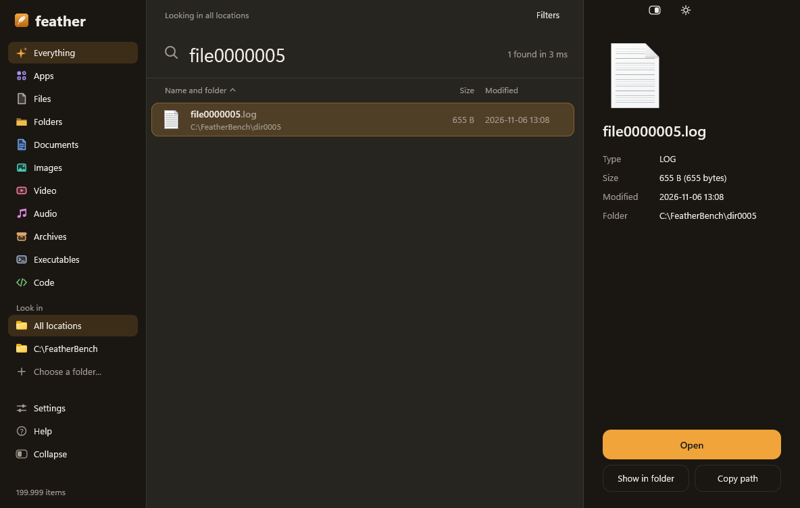
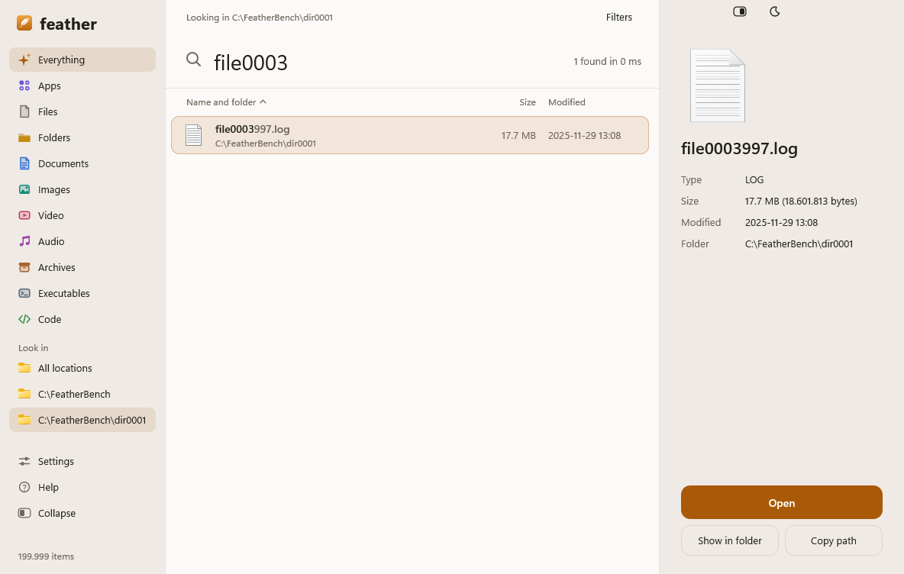
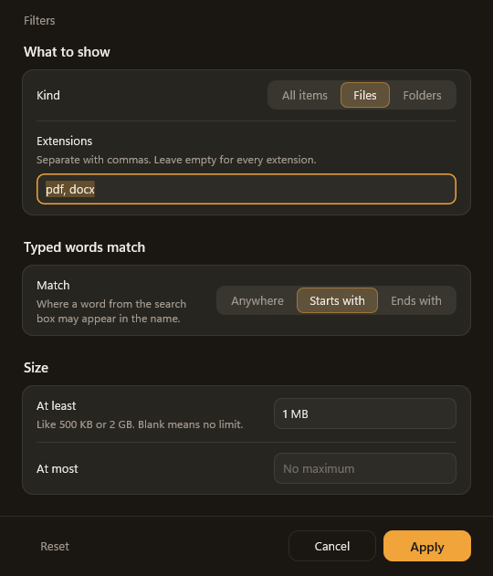
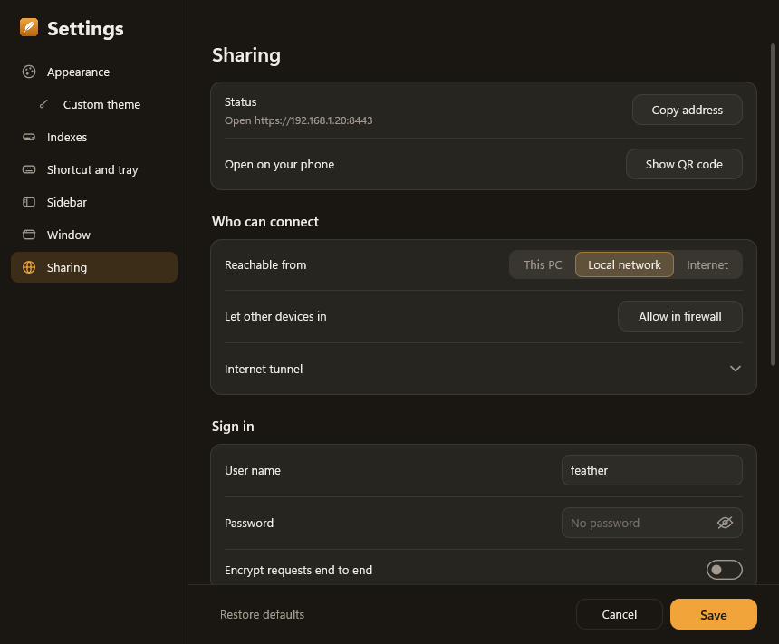
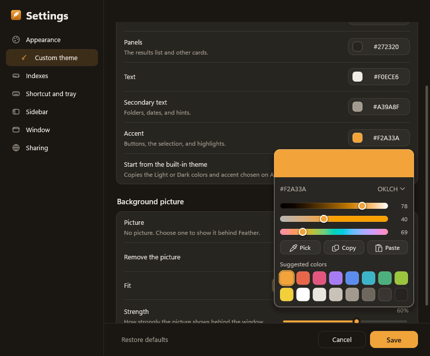

# Feather

[](https://github.com/nimao33/Feather/releases/latest)
[](https://github.com/nimao33/Feather/actions/workflows/ci.yml)
[](LICENSE)


A fast, low-memory file search for Windows (and Linux), written in Rust.

**[Download Feather for Windows](https://github.com/nimao33/Feather/releases/latest)**: run the
`.msi`, no admin rights needed.

Type part of a name and Feather lists every matching file and folder on your
drives as you type. It reads the NTFS file table directly, keeps its index in
memory-mapped files instead of RAM, and draws its own UI with Direct2D. There
is no .NET, WebView, GUI framework or async runtime underneath. It can also
share chosen folders to your phone or the internet through a small built-in
web page.



| Light theme | Filters |
| --- | --- |
|  |  |

| Sharing | Custom theme colors |
| --- | --- |
|  |  |

*Screenshots are from the built-in UI test (`--ui-test`) on generated demo data.*

## Features

- **Instant search** over millions of files. Results show up while you type,
  with the part of each name that matched highlighted.
- **Reads NTFS directly.** A small elevated helper reads the `$MFT` once
  (one UAC prompt). Other drives and folders fall back to a normal folder walk.
- **Stays up to date.** A file watcher notices changes and rebuilds only the
  drives that changed. Live, every 15 minutes, hourly or never.
- **Low memory.** The index is memory-mapped, so its pages are shared and
  dropped by Windows when it needs the RAM. Idle private memory is about
  25 MB for the window and about 15 MB for the helper.
- **Search syntax**: words, quoted phrases, `!` to exclude, `*` and `?`
  wildcards, `ext:`, `type:`, `size:`, `dm:`, `match:`, folder paths like
  `docs\report`, and `in:` scopes (see below).
- **Sidebar categories**: Everything, Apps, Files, Folders, Documents, Images,
  Video, Audio, Archives, Executables and Code, plus your own folders to look in.
- **Details pane** with the icon, type, size, dates, and Open, Show in folder
  and Copy path.
- **Real Explorer context menu** on right-click.
- **Global shortcut** (Ctrl+Space by default), tray icon, start at login.
- **First-run guide** that walks through where to search, the look, the
  shortcut and a few search tips.
- **Themes**: light, dark, Mica, Acrylic or solid backgrounds, accent colors,
  and a custom theme with your own colors and background picture. The color
  picker works in OKLCH, RGB and HSL and can pick colors from the screen.
- **Sharing** (off by default): a web page over HTTPS and an FTP server over
  TLS for the folders you choose, behind a password. It is reachable from this
  PC, your local network (with a QR code for your phone), or the internet
  through Cloudflare Tunnel, ngrok or a forwarded port. The web page shows
  photos and videos in place, with thumbnails, swiping and a video player
  made for phones.
- **CLI**: `feather search`, `feather index scan`, `feather config`, with
  JSON output.

## Benchmarks

Measured on an AMD Ryzen 5 5600G with 16 GB RAM and a SATA SSD (Samsung 870
EVO), Windows 11, release build.

### Typing a search on a real drive

A real index of C: and E: with **2,737,576 files and folders**. Every letter
is a new search. Since typing more letters only narrows the results, Feather
filters the results it already has when there are few enough, instead of
reading the whole index again.

| Typed | Results | Full search | Narrowed from the previous results |
| --- | ---: | ---: | ---: |
| `p` | 1,286,029 | 49 ms | – |
| `pa` | 134,445 | 26 ms | – |
| `pas` | 8,617 | 35 ms | 10 ms |
| `pass` | 7,657 | 19 ms | 0.6 ms |
| `passw` | 954 | 15 ms | 0.7 ms |
| `passwords` | 125 | 12 ms | 0.1 ms |
| `passwords.txt` | 30 | 14 ms | < 0.1 ms |

Full searches are split across all CPU cores. Path searches such as
`testbox\passwords.txt` check each folder once instead of each file, which
takes them from about 12 s to under 1 s on the same drive.

### Raw scan, 1,000,000 entries

One thread, generated demo data, 5 runs after a warm-up, 50,000 result cap:

```powershell
.\target\release\feather.exe --bench --index <dir> --iterations 5
```

| Query | Matches | p50 | p95 |
| --- | ---: | ---: | ---: |
| (empty) | 50,000+ | 0.40 ms | 0.44 ms |
| `file0000005` | 1 | 10.8 ms | 11.3 ms |
| `match:starts file` | 1 | 10.4 ms | 11.5 ms |
| `match:ends .pdf` | 50,000+ | 3.6 ms | 5.1 ms |
| `ext:pdf` | 50,000+ | 3.4 ms | 4.4 ms |
| `type:folder` | 2,000 | 4.3 ms | 6.4 ms |

### Building the index

A full rebuild of C: (2,655,088 entries, 334 MB index on disk), using the
folder-walk scanner so it can be measured without admin rights:

| | Peak private memory | Time |
| --- | ---: | ---: |
| Before the memory work | 881 MB | 38 s |
| Now | 286 MB | 21 s |

Names are kept end to end in one buffer instead of one string each, and the
index is encoded and written in slices instead of being assembled in memory
first. The NTFS reader is much faster than the walk: the whole of C: takes
seconds.

### Memory at rest

| Process | Private memory |
| --- | ---: |
| Feather window, 2.7 M items indexed | about 25 MB |
| Admin helper | about 15 MB |

The index files themselves are memory-mapped. Their pages count as shared,
not private, and Windows can drop them at any time.

More detail and the method are in [docs/benchmarks.md](docs/benchmarks.md).

## Search syntax

| Query | Meaning |
| --- | --- |
| `report budget` | names containing both words, in any order |
| `"annual report"` | the quoted phrase |
| `!temp` | leave out names containing `temp` |
| `*.pdf` | wildcard match |
| `docs\report` | `report` inside a folder whose name ends in `docs` |
| `C:\Users\` | list a folder, like an address bar |
| `ext:pdf;docx` | either extension |
| `type:folder` / `type:file` | folders or files only |
| `size:>10mb`, `size:1kb..2kb` | by size |
| `match:starts report`, `match:ends .pdf` | where words must appear in the name |
| `dm:today`, `dm:yesterday`, `dm:thisweek`, `dm:lastmonth`, `dm:thisyear` | modified in that period (`this`/`last` + `week`, `month`, `year`) |
| `dm:last7days`, `dm:30days`, `dm:24hours`, `dm:2weeks` | modified recently; days count today as the first |
| `dm:2026`, `dm:2026-11`, `dm:2026-11-11` | modified in that year, month, or day |
| `dm:2026-01-01..2026-03-31`, `dm:2026-06..`, `dm:..2025` | modified in a range, both ends included; either end may be open |
| `dm:>=2026-06`, `dm:>2026-06`, `dm:<2025`, `dm:<=2025` | from, after, before, or up to the end of a date |
| `in:"C:\Users"`, `!in:"C:\Windows"` | only inside, or never inside, a folder |

Words are case-insensitive. `date:` is the same as `dm:`. Dates are local
time; weeks start on the first day of the week set in Windows (Monday on
Linux). Folders match by their own date modified, as in Everything, and items
with an unknown date match no date filter. Several `dm:` filters must all match.

## Build

Windows, with Rust and the Visual Studio C++ build tools:

```powershell
cargo build --release
.\target\release\feather.exe
```

The release exe links the C runtime statically and needs nothing else
installed. `.\scripts\build.ps1` finds `vcvars64.bat` for you, and
`installer\` has Inno Setup and WiX scripts for an installer.

### Linux

The window there is a local page in an app window of your browser, so no GUI
toolkit is needed. It listens on 127.0.0.1 only, behind a random key.

```sh
sh scripts/install-linux.sh              # build, install to ~/.local/bin, add a menu entry
sh scripts/install-linux.sh --autostart  # also start at sign-in
sh scripts/install-linux.sh --static     # one musl binary for any distribution
```

On Linux the index is rebuilt by walking the folders, on a timer or on
"Reindex now".

## Command line

```powershell
feather search --limit 20 report pdf
feather search --json ext:pdf
feather index scan --root C:\Users --index my-index
feather index status
feather config list
```

`search` uses the same index and settings as the window. Settings live in
`%APPDATA%\Feather\settings.ini` and the index in `%LOCALAPPDATA%\Feather`.

## Tests

```powershell
cargo test --workspace
.\target\release\feather.exe --ui-test --screenshots shots --index shots\index
```

The UI test opens the real window offscreen, runs 37 scenarios (searching,
sorting, filters, every Settings page, the color picker, sharing) and saves a
screenshot of each.

## Layout

```
crates/feather-core   index format, memory mapping, NTFS reader, folder walk, query parser
crates/feather-app    Windows UI, search worker, sharing server, CLI, Linux window
scripts/              build, run, screenshots, UI test, memory measurement
installer/            Inno Setup and WiX installer scripts
docs/                 UI guide, index format, benchmarks, roadmap
```

## Not done yet

- The index is rebuilt per drive on changes, not updated entry by entry from
  the USN journal.
- No file watcher on Linux yet; the index refreshes on a timer there.

## License

[MIT](LICENSE)
